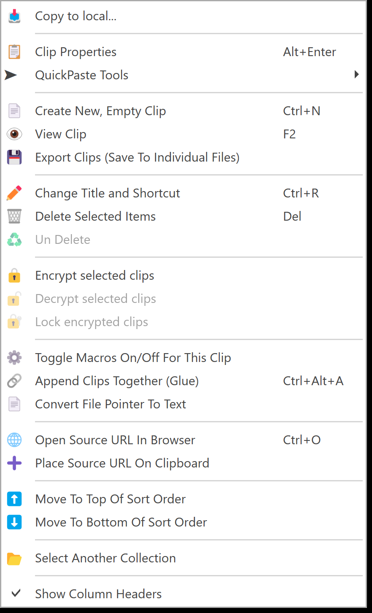
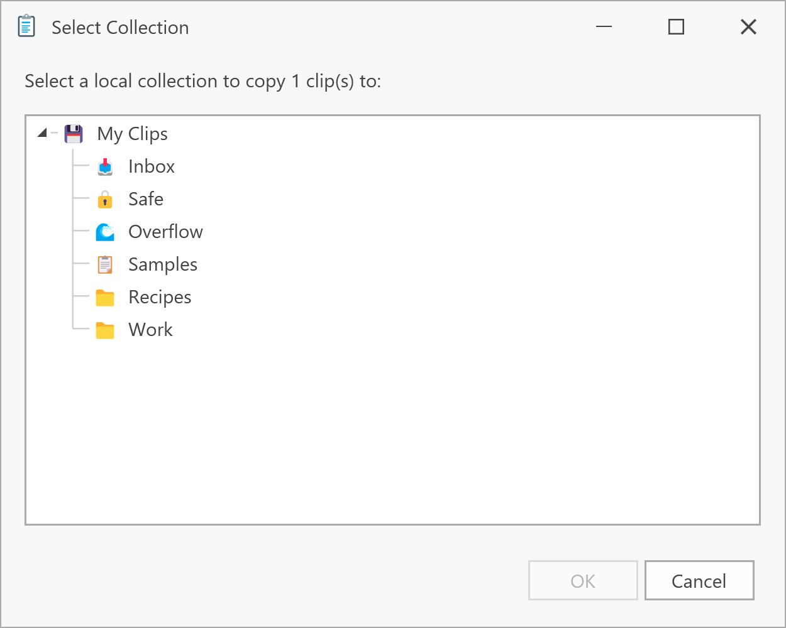

# Copy clips to local

To keep a clip from a Remote Database, copy it into one of your own databases.

1. In the clip list of a Remote Database, right-click the clip and choose **Copy to local...**.

   

2. Pick one of your own collections and click **OK**.

   

You can also drag remote clips onto one of your collections in the tree. This always copies, and never moves.

The copy is a new clip with all its formats, title, capture time and source. It's independent of the Peer, so it stays the same if the Peer changes or deletes the original, or goes offline. An encrypted clip stays encrypted, and the same passphrase opens it.
