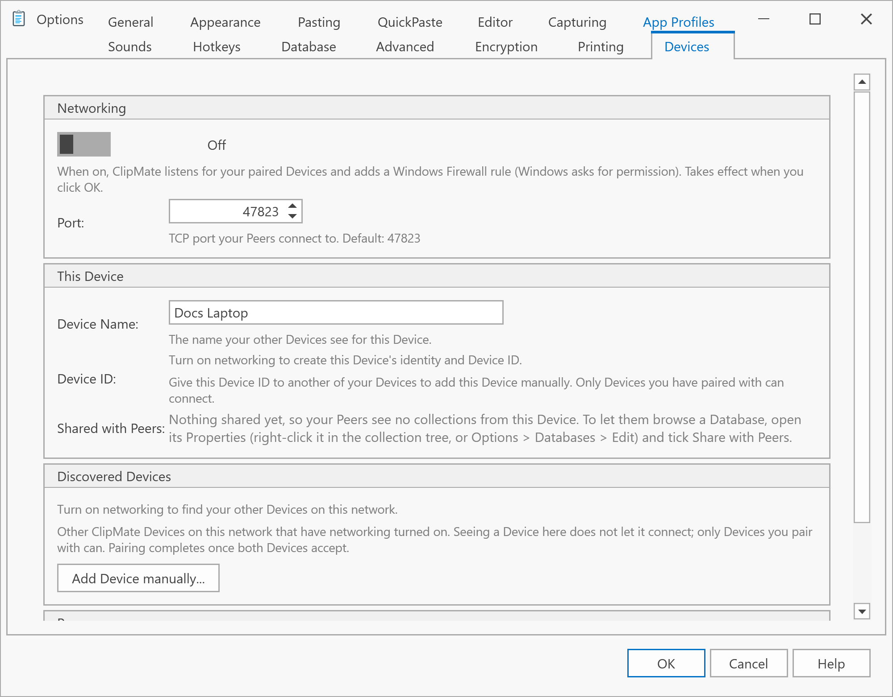
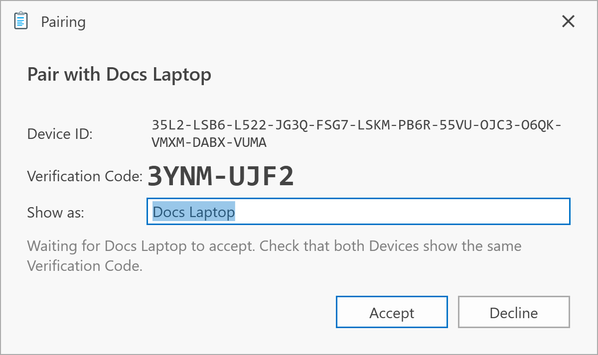
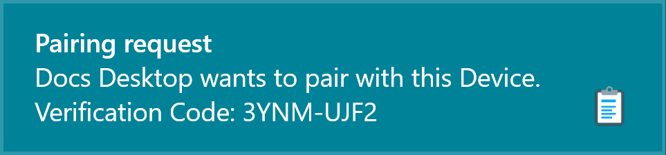
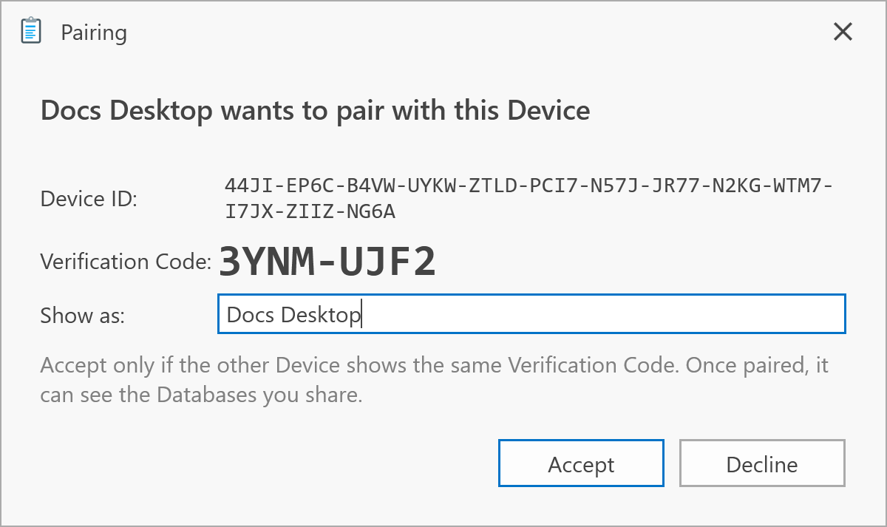

# Pair your Devices

Pairing makes two of your Devices trust each other. It finishes only when you've accepted on both.

## Turn on networking on both Devices

Do this on each computer:

1. Open **Tools > Options...** and choose the **Devices** tab.
2. Under **Networking**, turn the switch on.
3. Under **Device Name**, give the Device a name you'll recognize, such as Laptop.
4. Click **OK**. Windows asks for permission to add a firewall rule for ClipMate. Accept, so your other Devices can reach this one.

## Pair them

1. On one Device, reopen the **Devices** tab. Within about 30 seconds, the other Device appears under **Discovered Devices**.
2. Click **Pair...** next to it. A **Pairing** window opens with a Verification Code.

   

3. On the other Device, a notification shows the same request and code. Click it, or wait a moment, and a **Pairing** window opens.

   

   

4. Check that both Devices show the same Verification Code. If they don't, click **Decline**.
5. Click **Accept** on both Devices.

Each Device now lists the other under **Peers**, with its status. To go on, see [Share and search databases](share-and-search.md).

## If the other Device doesn't appear

- Check that the **Networking** switch is on for both Devices.
- Make sure both are on the same network, and that Windows treats it as Private. See [Network and firewall](../troubleshooting/network.md).
- For a Device on another network, use **Add Device manually...**. See [Devices Options](../options/devices.md#add-device-manually).

## Unpair a Device

On the **Devices** tab, click **Unpair** next to the Peer and confirm. It takes effect on both Devices.
