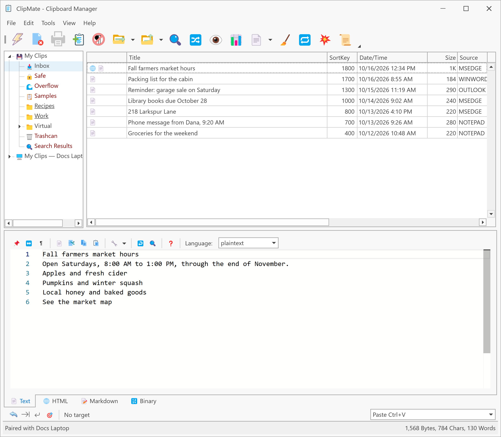
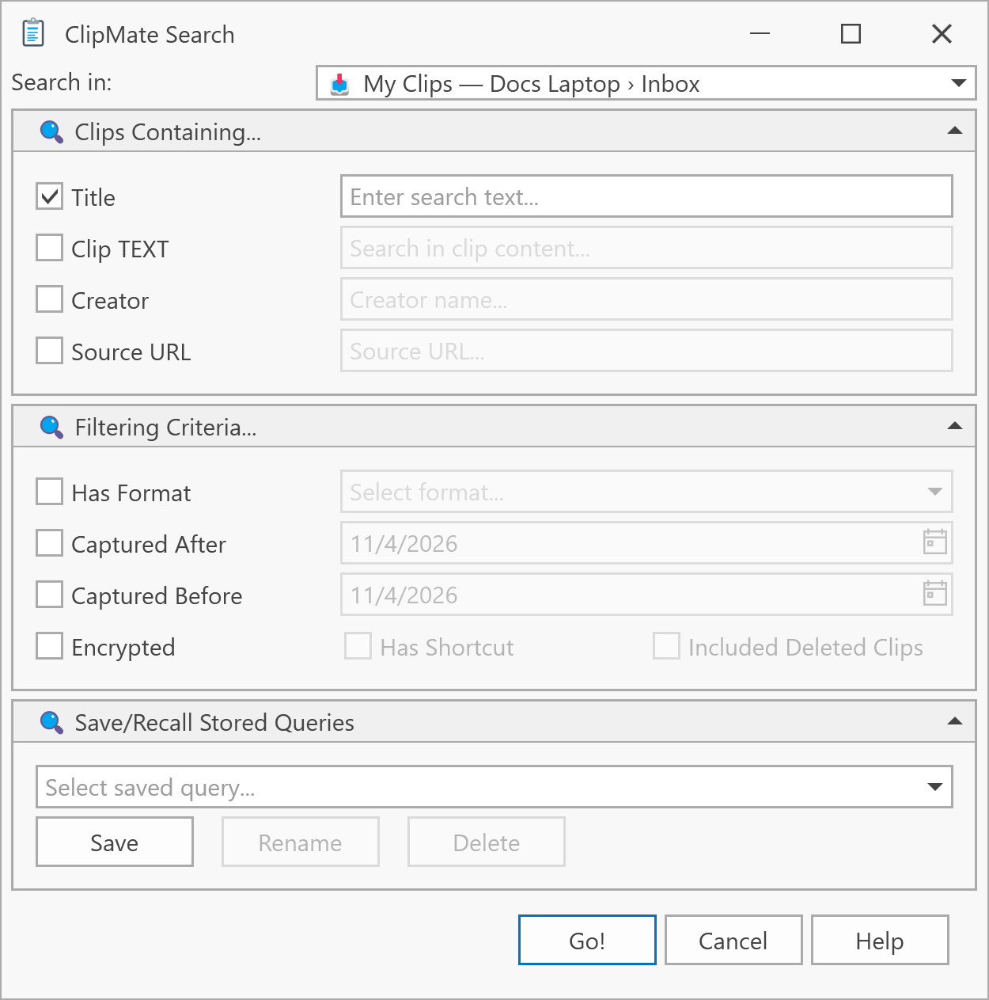

# Share and search databases

Pairing alone shares nothing. You choose which databases your Peers can read, and they can't change anything in them. A Peer is another of your Devices that you've paired with this one.

## Share a database

1. On the Device that has the clips, open **Tools > Options...** and choose the **Database** tab.
2. Select the database and click **Edit**.
3. Tick **Share with Peers**, then click **OK** in each window.

## Browse a Remote Database

On your other Device, the shared database appears at the bottom of the collection tree as a Remote Database, labeled with the database and Device names. Click one of its collections to list the clips.

Clicking a remote clip puts it on the clipboard, ready to paste, but doesn't add it to your own databases. If you want to keep it, see [Copy clips to local](copy-to-local.md).

When the Peer is offline, its Remote Databases stay in the tree, grayed out.

## Search a Remote Database

1. Select the Remote Database, or one of its collections.
2. Open the Search dialog with **Ctrl+F**. **Search in** shows the Remote Database.
3. Enter what you're looking for and click **Go!**.

The matches appear in a new item under the Remote Database, named after your search. You get up to 1,000 of the newest matches, so narrow your search if the list says there are more.

To search everything at once, choose **All Databases** in **Search in**.

A search of a Remote Database has a few limits:

- Saved searches written as SQL aren't offered.
- Deleted clips and shortcuts aren't shared, so you can't search on them.
- Encrypted clips match only on what isn't encrypted, such as the date or the program they came from.
