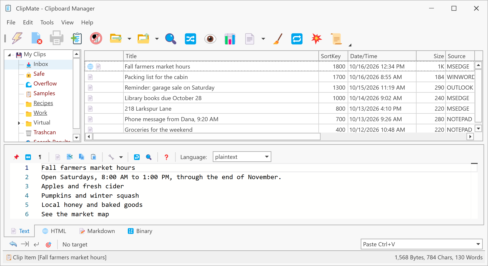

# Your first clips

A clip is one thing you copied, kept by ClipMate. There's nothing to turn on: while ClipMate is running, it captures each copy.

## Capture some clips

1. Select each line below in turn and press **Ctrl+C**:

   ```text
   Apples
   Bread
   Coffee
   ```

2. Click the ClipMate icon in the system tray.

Each line is now a clip at the top of the **Inbox** collection, newest first, with the time you copied it and the program it came from.



## Paste an earlier clip

1. Click **Apples** in the clip list. ClipMate puts it on the clipboard.
2. Switch to any program you can type in, such as Notepad.
3. Press **Ctrl+V**.

You've just pasted something you copied two copies ago, which the Windows clipboard alone can't do.

## Keep a clip

ClipMate removes the oldest clips from the Inbox as new ones arrive, so anything you want to keep belongs in another collection. The **Safe** collection never deletes clips by itself.

Drag **Apples** from the clip list onto **Safe** in the collection tree on the left.

## Next step

ClipMate has two windows for different jobs. See [The two windows](the-two-windows.md).
