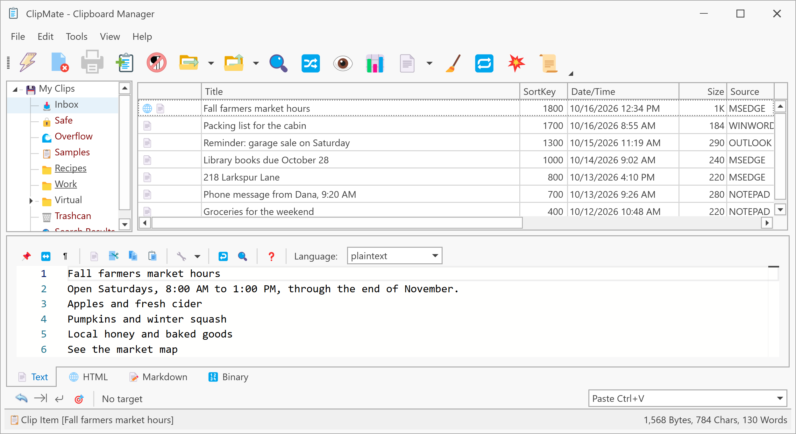
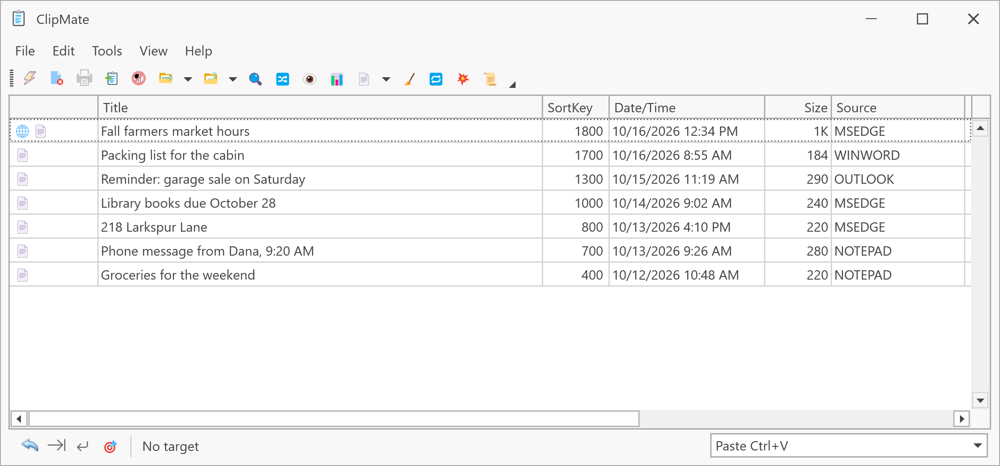

# The two windows

ClipMate has two main windows that show the same clips. Use whichever suits what you're doing, and press **Ctrl+E** in either one to switch to the other.

## ClipMate Explorer

Use Explorer to organize, search and edit your clips. It has your collections on the left, the clip list at the top right, and the selected clip's content below it.

Clicking the tray icon opens Explorer. See [ClipMate Explorer](../user-interface/clipmate-explorer.md) for more.

## ClipMate Classic

Use Classic when you want your clips close at hand while you work in another program. It's smaller, with the toolbar and the clip list.

Right-click the tray icon and choose **Open ClipMate Classic**. See [ClipMate Classic](../user-interface/clipmate-classic.md) for more.

## Next step

From here, the [tutorial](../tutorial/index.md) walks through pasting, PowerPaste and more.
