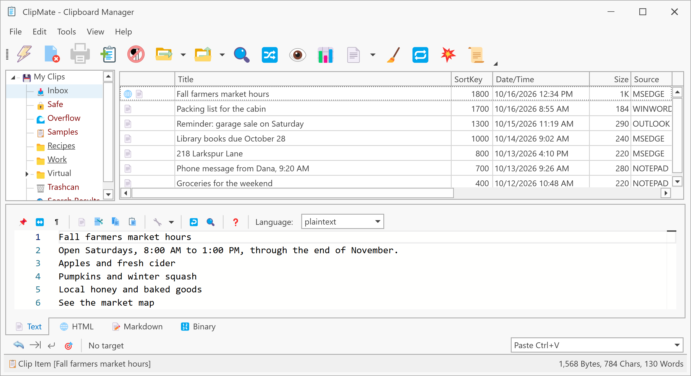

# Introducing ClipMate

ClipMate remembers everything you copy. The Windows clipboard holds one thing at a time, and each copy replaces the last. ClipMate keeps every text, picture and file list you copy, so you can find it and paste it again days or months later.

## What you can do with it

- **Paste any earlier clip.** Pick a clip, and it's ready to paste into whatever you're working in.
- **Paste a series of clips.** With PowerPaste, each paste moves on to the next clip, which is handy for filling in forms.
- **Keep clips organized.** Sort them into collections, such as Recipes or Work, and find them with search.
- **Edit and clean up clips.** Change the text, fix its case, and remove stray line breaks before you paste.
- **Use your clips on your other computers.** Pair your own computers so each can browse and search the clips the others share.

ClipMate runs on Windows and is free and open source.

## Where to go next

- New to ClipMate? Start with [Install ClipMate](get-started/install.md).
- Used ClipMate 7 before? See [ClipMate 7 Import](coming-from-clipmate-7/import.md).
- Have more than one computer? See [Use ClipMate across your Devices](devices/index.md).
