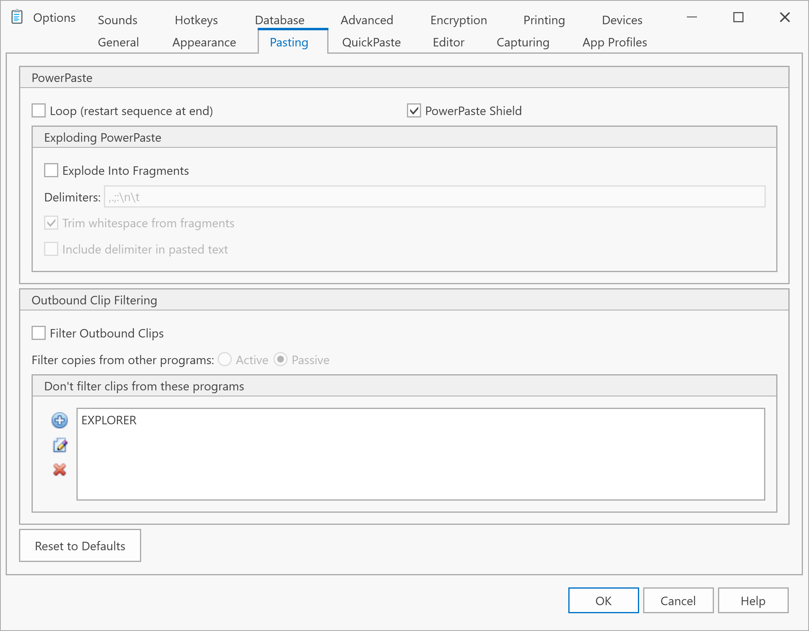

# Pasting Options

{/*  */}

These settings control how ClipMate pastes data to applications.

## Exploding PowerPaste

While PowerPaste normally pastes one clip at a time, Exploding PowerPaste can break up formatted text and paste individual fields. For example, comma-delimited data can be pasted field by field.

### Configure Delimiters

Specify characters that separate fragments:
- Commas: `,`
- Tabs: `\t`
- Line breaks: `\n`
- Spaces: ` ` (space character)

Default delimiters: `,.;:\n\t`

### Options

| Option | Effect |
|--------|--------|
| **Strip Delimiter** | Remove the delimiter character from pasted data |
| **Strip Spaces/Control Characters** | Remove whitespace and control characters |

See [PowerPaste](../user-interface/main-toolbar/powerpaste.md) for details on how Exploding PowerPaste works.

## PowerPaste Loop

Enable looping to restart the PowerPaste sequence after completing, rather than stopping.

:::note Location
This option is on the main menu under **Edit**, not in this dialog. Click to toggle on/off.
:::

## PowerPaste Shield

PowerPaste Shield is on by default. It stops other programs that read the clipboard, such as clipboard history or another clipboard manager, from moving PowerPaste on to the next clip, which is called "fast-forwarding."

If PowerPaste doesn't advance when you paste into a program, turn this option off. Then any program reading the clipboard moves PowerPaste on, so it may skip clips if such a program is running.

## Hide Clips From Other Programs

This option is off by default, so every program that reads the clipboard gets the clip, as in ClipMate 7. It works only while PowerPaste Shield is on.

Programs that read the clipboard in the background can get in the way of a paste, mostly on a busy computer or when you paste quickly. PowerPaste may repeat a clip, or a paste may put in nothing. If this happens to you, turn this option on.

While PowerPaste is on, programs in the background then get nothing from the clipboard. These include clipboard history, other clipboard managers, and the clipboard sharing in Remote Desktop and WSL. They can read the clipboard again when PowerPaste stops.

If pasting into a program puts in nothing with this option on, turn it off.

## Filter Outbound Clips

Toggle [Outbound Clip Filtering](../user-interface/main-toolbar/outbound-clip-filtering.md) with two modes:

### Passive Filtering

Requires you to:
1. Bring ClipMate to the foreground
2. Dismiss to background
3. Clipboard updates with filtered clip as focus is lost

This is similar to ClipMate 6.5 behavior.

### Active Filtering

Updates the clipboard immediately when any new clip arrives:
1. Copy HTML from browser
2. ClipMate captures all formats (Text, RTF, HTML)
3. Within ½ second, clipboard is replaced with plain-text version
4. A "whoosh" sound plays
5. Paste as plain-text without interacting with ClipMate

:::caution File Operations
Outbound filtering (especially active mode) disables copy/paste of files in Windows Explorer. This is expected behavior—ClipMate is replacing clipboard contents with plain text as instructed.
:::

## See Also

- [PowerPaste](../user-interface/main-toolbar/powerpaste.md)
- [Outbound Clip Filtering](../user-interface/main-toolbar/outbound-clip-filtering.md)
- [Application Profile](application-profile.md)
